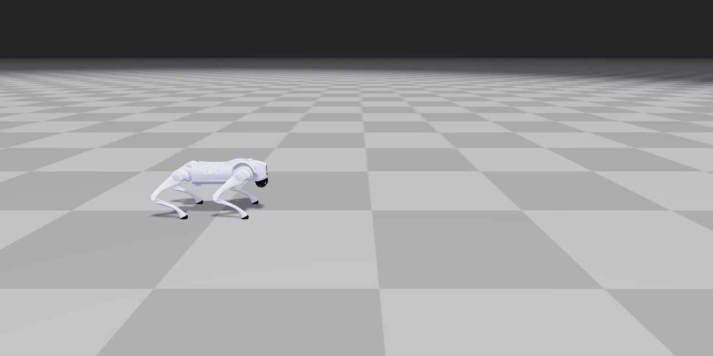
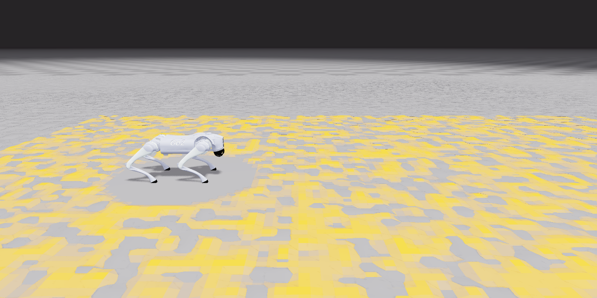
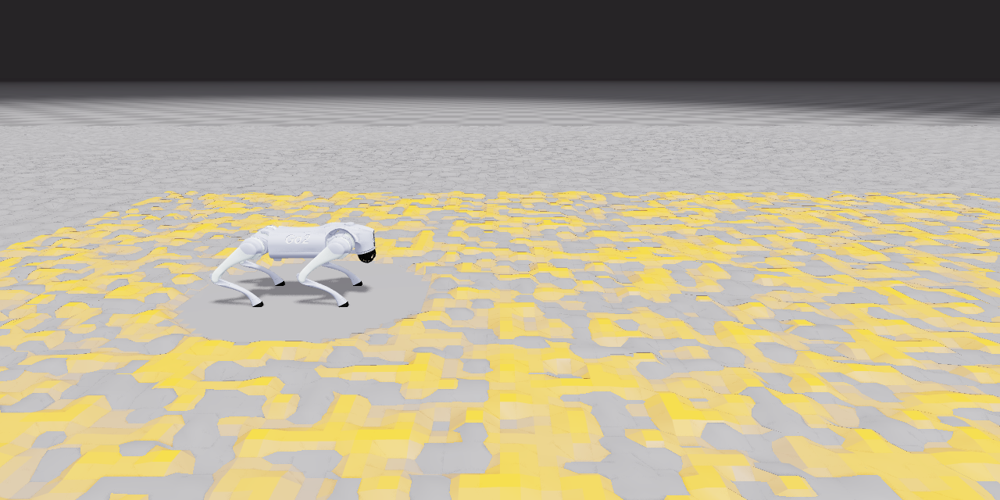
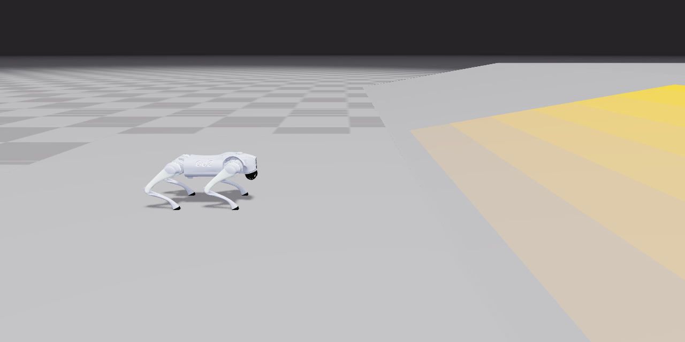
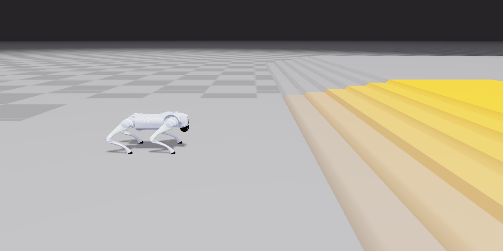
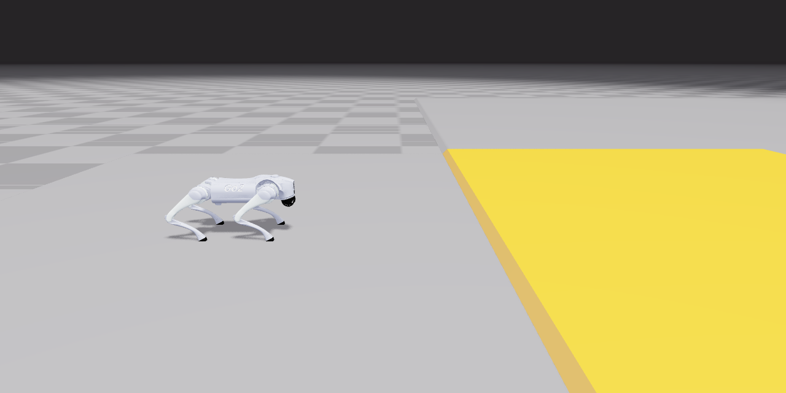
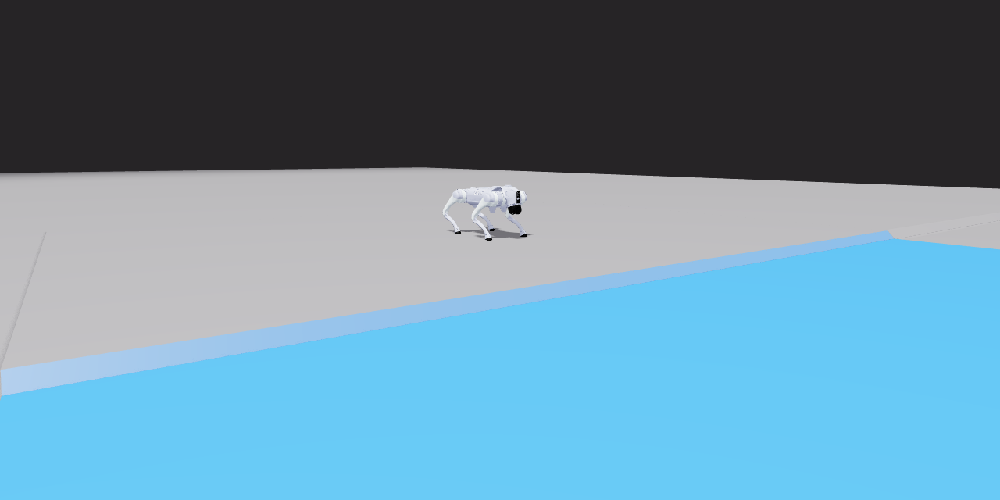

# newtonian


ROS 2 package that runs [Newton](https://github.com/newton-physics/newton) physics simulations as ROS 2 nodes ; the scene (environments, inputs, robots, sensors, solvers) is described in one YAML parameter file, allowing the simulator to be built and rebuilt at runtime.

## License

This package is released under an [MIT license](https://github.com/marinarasauced/newtonian/blob/main/LICENSE).

Authors : [Marina Nelson](https://github.com/marinarasauced) <br/>
Maintainer : Marina Nelson, marinarasauced@outlook.com

Parts of this package (benchmarking, code reviews, documentation) were developed with the assistance of Claude Opus 5.5 and Claude Sonnet 5.5, AI models by Anthropic.
All AI contributions were reviewed, tested, and applied by the author.

## Contents

- [Requirements](#requirements)
- [Installation](#installation)
- [Usage](#usage)
- [Benchmarks](#benchmarks)
- [Docs](#docs)

## Requirements

| Component | Version tested |
|---|---|
| ROS 2 | Lyrical |
| Python | 3.14 |
| Newton | 1.8.0 |
| Warp | 1.18.0 |
| GPU (optional) | NVIDIA, CUDA 13 |

The Python dependencies are installed with pip into a virtual environment.
Alternatively, they may be installed directly to the site packages, but this is not recommended.
The ROS dependencies are installed with rosdep.

<!-- ## Architecture

```zsh
newtonian/

    node.py                  ROS 2 node

    modules/
        params.py            Parameters
        registry.py          Registry
        arrays.py
        transforms.py
        paths.py

        physics/
            simulator.py     NewtonianSimulator
            viewer.py        NewtonianViewer

        plugins/
            base.py          Plugin
            environments/    groundplane, track
            robots/          mjcf, urdf, usd
            sensors/         imu, lidar, camera, odometry, jointstate, contact
            inputs/          racecar, jointcommand, markers
            solvers/         mujoco, featherstone, kamino, xpbd

config/                      parameter files
descriptions/                robot files
launch/                      sim.launch.py
``` -->

## Installation

Clone the package into your workspace.

```zsh
cd ~/ros2_ws/src
git clone https://github.com/marinarasauced/ros2_newton newtonian
```

Install all Python dependencies into a virtual environment.

```zsh
python3 -m venv ~/.virtualenvs/newtonian
source ~/.virtualenvs/newtonian/bin/activate
pip install -r ~/ros2_ws/src/newtonian/newtonian/requirements.txt
```

Install all ROS dependencies.

```zsh
cd ~/ros2_ws
rosdep install --from-paths src --ignore-src -r -y
```

Build the package.

```zsh
python3 -m colcon build --symlink-install --packages-select newtonian
source install/setup.zsh
```

With `--symlink-install`, changes to the existing Python code and to the `config/*.yaml` files take effect without rebuilding the package.

## Usage

Start the example scene of a racecar on a pear-shaped track.

```zsh
ros2 launch newtonian sim.launch.py
```

Start your own scene.

```zsh
ros2 launch newtonian sim.launch.py config:=/path/to/your/scene.yaml
```

## Benchmarks

Robustness benchmark of controllers on the simulator, in the package `newtonian_benchmarks`. A controller is any ROS 2 node (Python, C++, Rust) that follows the contract in [docs/benchmarks.md](docs/benchmarks.md#controller). The benchmark runs it against scenes with rough terrain, low friction, pushes, latency, and payload, and reports survival, tracking error, recovery, and real-time feasibility. The keys of the config file are in the same page.

### Layout

The package has the same layout as `newtonian` : a ROS 2 node, `modules`, and plugins that register under a name. The Python code is generic : it names no robot, controller, or topic. Everything that can change is in one YAML file in `config/`.

<!-- ```
newtonian_benchmarks/
  config/
    benchmarks.yaml     the one config file : robot (with its simulator scene), controller, axes, suites
  newtonian_benchmarks/
    node.py                      BenchmarkNode (ROS 2 node) and main(), entry point 'bench'
    modules/
      paths.py                   find the config file
      config.py                  load the file, robot defaults, scene
      sweep.py                   axis library, suites, sampling, trials, scene files
      units.py                   relative units (body weight, standing height, mass fraction)
      hooks.py                   requests to the simulator hooks (/newtonian/configure)
      report.py                  report.md and summary.json
      compare.py                 compare.md : controllers side by side
      plots.py                   interactive plots (Plotly)
      runner/
        runner.py                BenchmarkRunner : trials, results, reanalyze
        session.py               Session : one simulator + controller for one scene
        processes.py             Process : child process with a log file
      plugins/
        base.py                  Plugin
        profiles/                command profiles   step, ramp, sine, stop_and_go
        metrics/                 metrics            survival, tracking, attitude, pushes, power, controller, realtime
    example.py                   example controller for unitree_go2 only, entry point 'example'
  test/
``` -->

- **Plugins.** A command profile or a metric is a class registered under a name (`@PROFILES.register("step")`, `@METRICS.register("tracking")`) and imported in the `__init__.py` of its folder, as sensors and inputs are in `newtonian`. They use the `Registry` of `newtonian`. A new profile needs one file. A new metric needs one file and a name in `ORDER` of `metrics/__init__.py` ; a metric adds keys to the dict of the trial and may read the keys of the metrics before it.
- **One config file.** Everything that can change is in `config/benchmarks.yaml` : the robot, its simulator scene, the controller, and the suites. There are no folders of robots or controllers. To use another robot or controller, edit the blocks in the file, or copy the file and pass its path with `--config` ; no code changes.
- **Import order.** `node` imports `modules.runner.runner`, which imports `session`, `sweep`, `config`, `plugins.metrics`. `modules` never imports `rclpy` or `node`, so `--reanalyze` and the tests run without ROS.

### Run

```zsh
ros2 run newtonian_benchmarks bench --only smoke --out results/smoke              # 4 trials, about 1 min
ros2 run newtonian_benchmarks bench --out results/all                              # all suites of config/benchmarks.yaml
ros2 run newtonian_benchmarks bench --only push_on_terrain,latency --out results/p
ros2 run newtonian_benchmarks bench --config /path/to/my.yaml --out results/mine   # another config file
ros2 run newtonian_benchmarks bench --reanalyze --out results/all   # new metrics or thresholds, no new run
ros2 run newtonian_benchmarks bench --compare results/a results/b --out results/compare   # controllers side by side
```

The runner starts one simulator and one controller for each scene (terrain), and resets the simulator between trials. It writes :

| File | Content |
|---|---|
| `results.csv` | one row per trial: axes, metrics, pass |
| `report.md` | scorecard, pass rate (🟥 🟧 🟨 🟩) by axis and by pair of axes, failed trials (`report_<name>.md` and `compare.md` for several controllers) |
| `summary.json` | scorecard numbers |

With two or more `controllers` in the config file, one run does every trial with each of them and writes `report_<name>.md` and `compare.md`. `--compare` does the same for runs made apart : it reads the `results.csv` of two or more runs of the same suites and writes `compare.md` : a scorecard of the controllers (best value in bold), pass rates by suite and by axis, one grid for each pair of axes and each controller, and a table of the trials where they differ. The trials are joined by their id, which depends on the axes and the seed only, so the runs must use the same config except for the controllers.

The plots are interactive files in `plots/` (Plotly, open them in a browser, zoom and hover) with the library next to them, linked from the markdown :

- `pass_rate_by_axis.html` : pass rate against each varied axis, one line for each controller (`compare.md`) ;
- `failure_reasons.html` : failed trials by reason (fell, tracking, roll/pitch, recovery, or a run error), one bar for each controller (`compare.md`) ;
- `timeline_<controller>_<id>.html` : height, roll and pitch, and velocities against the commands for the first 3 failed trials of a controller, with the pushes and the fall marked (`report_<name>.md`, or `report.md`).

The plots need the Python package `plotly`.
| `traces/<name>/<id>.npz` | ground-truth odometry, controller command times, command profile, timing |
| `plots/` | interactive Plotly files (see below) |
| `logs/` | log of each simulator and controller process |

The run uses one ROS domain (`--domain`, default 60) for the simulator, the controller, and the benchmark node. Runs are one after the other ; there are no parallel jobs.

### Terrains

The axis `terrain` builds a heightfield around the origin. A flat disk of 0.6 m radius at the start (`clear`) keeps the robot on flat ground at the beginning of a trial. The images are renders of the Newton viewer, with the sky and the ground color of the scene, the unitree_go2 standing at the start, and the values of `config/benchmarks.yaml` (standing height 0.27 m). The terrain is colored by its height : grey is the ground level, yellow is higher, and blue is lower. The scale of the colors is different in each image.

| Terrain | Keys | Image |
|---|---|---|
| `flat` | |  |
| `noise` | `amplitude` (m), `cell` (m, default 0.1), `seed` |   |
| `slope` | `angle` (°), `length` (m, default 4), `start` (m) |  |
| `stairs` | `step_height` (m), `step_length` (m, default 0.35), `steps` (default 6), `start` (m) |  |
| `step`, step up | `step_height` (m), `start` (m) |  |
| `step`, step down | the same, with `direction: down` |  |

In the benchmark, `amplitude_rel` and `step_height_rel` are multiples of the standing height of the robot. The two noise images are `amplitude_rel: 0.07` and `0.15`. The steps are `{kind: step, step_height_rel: 0.2, start: 1.5}`, and the same with `direction: down`. `direction: down` mirrors the heights : the ground goes down by the step height after `start`.

### Metrics

All from the ground truth. Times are sim time. The trial starts after `settle` s of standing.

| Metric | Meaning |
|---|---|
| `fell`, `time_to_fall` | tilt of the base above `fall_tilt` (1.0 rad) or base height below `fall_height` (0.10 m) |
| `rmse_vx`, `rmse_vy`, `rmse_wz` | error to the command over the whole run; `rmse_ss_*` skips the first `transient` (1 s) |
| `height_std`, `height_mean` | base height |
| `roll_max`, `pitch_max`, `roll_rms`, `pitch_rms` | attitude |
| `rp_exceed_frac`, `rp_exceed_events` | share of time and number of episodes with roll or pitch above `rp_limit` (0.35 rad) |
| `recovered`, `recovery_time` | after the end of each push: first time that the smoothed tilt, velocity error, and yaw-rate error are within a margin of their values before the push for `recover_hold` (0.5 s); worst push; not recovered if the robot fell or did not settle in `recover_window` (4 s) |
| `peak_tilt_push`, `peak_vel_dev_push` | worst deviation after a push |
| `mech_power`, `effort_max` | from the joint states (needs actuator forces of the solver) |
| `cmd_rate_hz`, `cmd_gap_max`, `cmd_missed_frac`, `cmd_rate_ratio` | joint commands of the controller in sim time. A command is missed if the gap to the one before is longer than 1.5 periods (1 / `rate_hz`) plus 2 ms. `cmd_rate_ratio` is the rate against `rate_hz` |
| `sim_rtf`, `sim_overrun_frac` | speed of the simulator in the trial |
| `rt_ok` | simulator at the target speed (≥ 97 %), at most 10 % late frames, controller at ≥ 90 % of `rate_hz`, less than 1 % missed cycles, no pause of 0.1 s |
| `pass` | no fall, every `max_<metric>` of `pass` respected, recovery if `require_recovery` |

### Real-time and speed

The simulator and the controller run at the same time and talk only through ROS topics, as on a robot. Nothing waits for the other side. A trial is a valid real-time test when `rt_ok` is true.

| `rtf` | Behavior |
|---|---|
| `1.0` | real time. Reference result |
| a number | faster run. Both sides use sim time, so a controller that keeps its rate at that factor also keeps it at real time |
| `auto` | the runner probes the factors of `rtf_candidates` (default 1, 1.25, 1.5, 2, 3, 4) with the controller standing. It takes the largest one at which the simulator reaches the speed, has few late frames, and the controller keeps its rate. The probes are in `calibration_*.json` |

Results at a factor above 1 should be checked at 1.0 for the trials that matter (falls, borderline). The ROS jitter and the load of the computer scale with the factor.

### Simulator hooks

All hooks are off by default. They are used through the service `/newtonian/configure` (`newtonian_srvs/srv/Configure`, JSON string in and out).

| Key | Action |
|---|---|
| `reset`, `defaults` | reset the scene; restore friction, payload, latency |
| `seed` | reseed the random generator of the simulator (jitter, drop, sensor noise) |
| `friction`, `payload_mass` | change the model at run time (no rebuild) |
| `state` | start state; applied when the warm-up ends |
| `push` | list of `{force, torque, start, duration, body}`; added to `body_f` inside the CUDA graph |
| `inputs`, `sensors` | `{name or *: {latency, jitter, drop}}`; also keys `latency`, `jitter`, `drop` in the scene yaml |
| `rtf` | change the real-time factor |
| `timing`, `query` | return the speed since the last call; `info` |

New environment : `terrain` (heightfield : `noise`, `slope`, `stairs`, `step`).

### Limits

- Only unitree_go2 has a scene file. A new robot needs a scene with a ground-truth sensor, written in the `robot:` block.
- Sensor latency delays the whole message ; the stamp stays the stamp of the measurement.
- The simulator is a Python node. At 500 Hz one frame takes about 1 ms, so the factor is limited to about 1.25.
- A trial after a reset starts with the robot standing (drives are not lazy in the scene of `config/benchmarks.yaml`). The warm-up of the scene settles it.
- Results vary between runs (GPU, ROS timing). Use several seeds (`seeds` of the file) and look at the spread.

## Docs

AI generated documentation from Claude Opus 5.5.

| Page | Contents |
|---|---|
| [Configuration](docs/configuration.md) | all YAML keys, with defaults and units |
| [Development](docs/development.md) | code layout, how to add a plugin |
| [Runtime](docs/runtime.md) | topics, services, viewer controls, rebuild |
| [Troubleshooting](docs/troubleshooting.md) | errors and their fixes |
| [Benchmarks](docs/benchmarks.md) | benchmark config file : robot, controller, axes, suites |